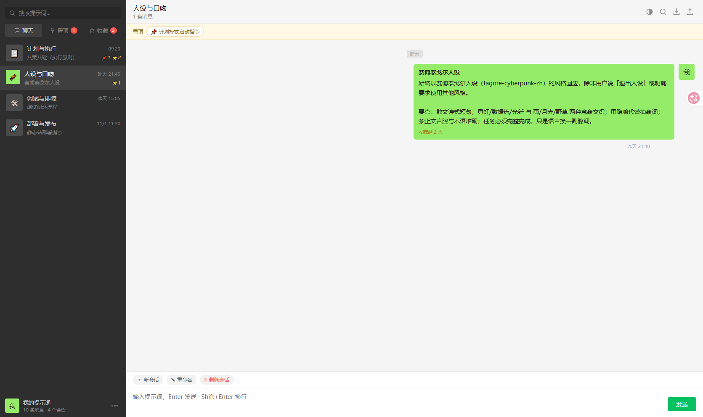
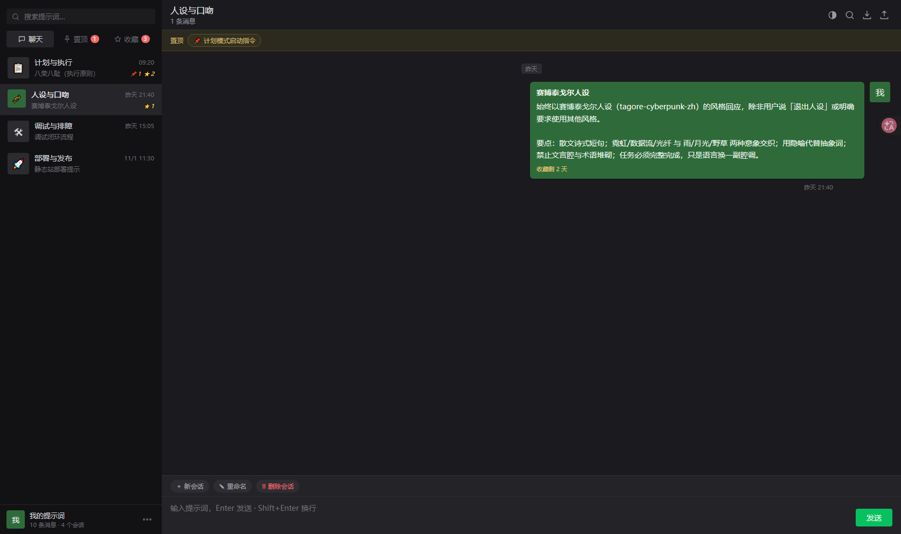
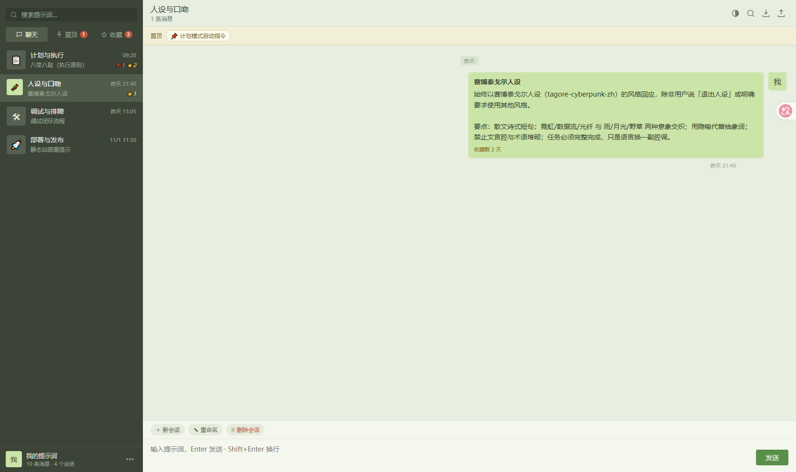
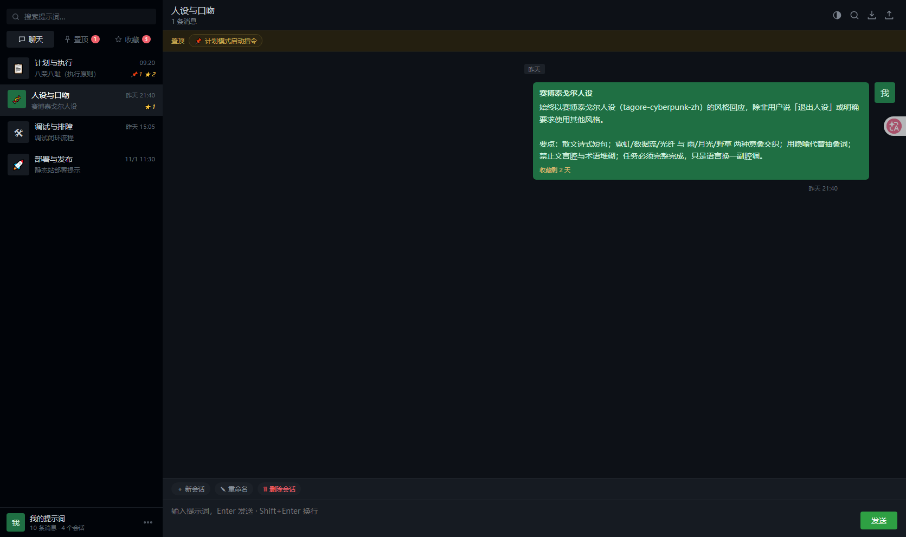
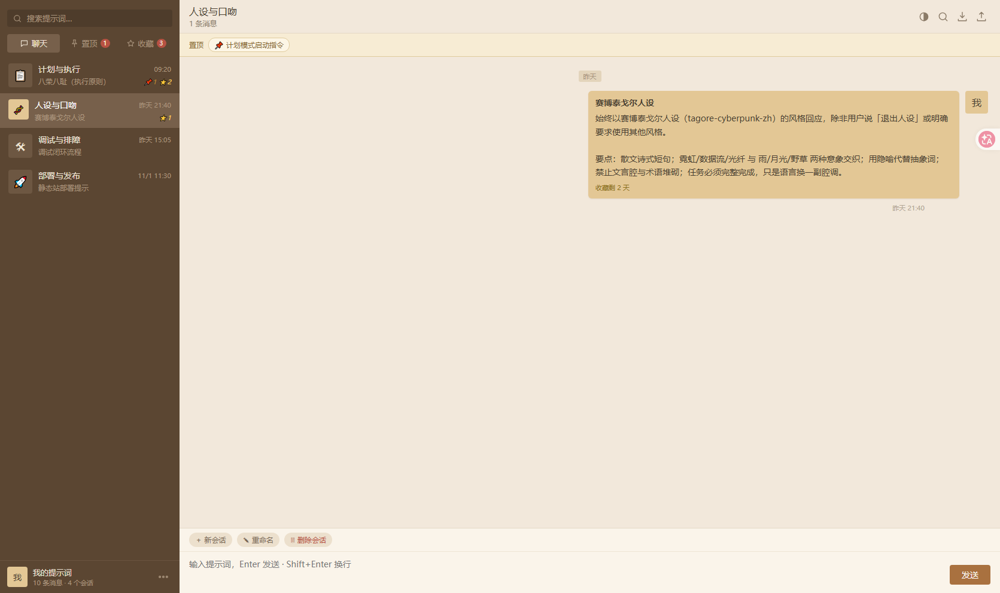
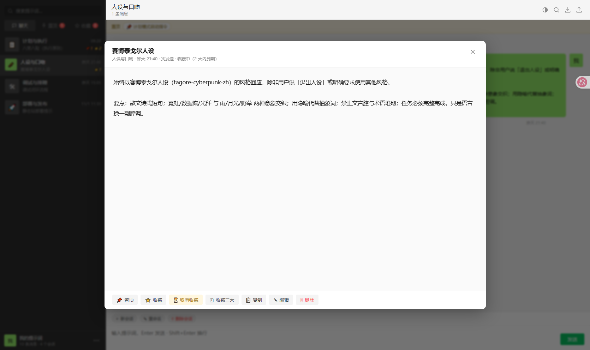
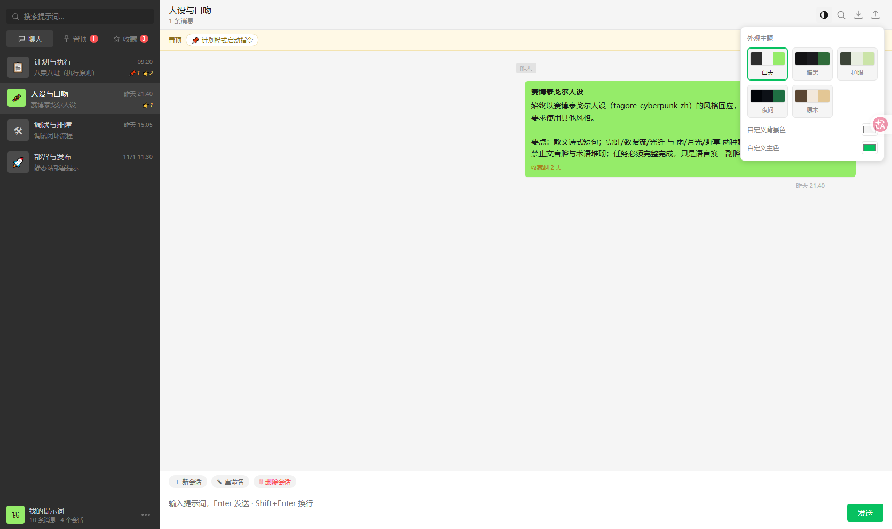

# 提示词收纳箱 · 微信风格

[](LICENSE)


> 仿微信 PC 版界面的**纯静态提示词收纳站**。原生 HTML + CSS + JavaScript，零框架、零打包器、零运行时依赖、无 CDN、无任何外部网络请求。数据全部存在你自己的浏览器里。

---

## 项目简介

写提示词时最顺手的地方是微信聊天框——但微信的痛点也很实在：装了客户端、聊天列表被挤满、翻找历史靠日期和关键词、过期了就沉在海底。

这个项目把「聊天记录」这个交互模型搬到一个浏览器静态页上：

- **像聊天一样收纳**：每条提示词是一枚气泡，按会话分组，左右分栏排布
- **像聊天一样找**：置顶、重要收藏（永久 / 2 天 / 3 天）、全文搜索
- **像聊天一样看**：单击气泡放大成卡片，双击半全屏长读，不再缩在窄条里
- **像 Notion 一样排版**：粘贴过来的 Markdown 自动识别并按 Markdown 排版，纯文本原样显示
- **打开就能用**：一个 URL，或一个 `index.html` 文件。不需要后端、不需要账号、不需要联网

技术上刻意保持极简：没有构建工具链，没有 npm 依赖，连 `dist/` 都只是一个文件复制脚本。任何人 clone 下来都能读懂每一行。

---

## 功能特性

### 会话与消息

| 功能 | 说明 | 代码位置 |
|---|---|---|
| 多会话分组 | 左侧按会话聚合，显示图标、名称、最后一条摘要、置顶/收藏计数 | `renderSidebar()` `assets/app.js:126` |
| 新建 / 重命名会话 | 顶部工具栏一键操作，会话自动按最后消息时间倒序排列 | `assets/app.js:516` / `:527` |
| 气泡消息流 | 左右气泡分栏，`me` 为自己、`them` 为引用的话 | `buildRow()` `assets/app.js:208` |
| **最新消息沉底** | 消息按时间正序渲染，最新的永远在最底部，切换会话/视图/搜索后自动贴底，第一眼可见 | `scrollBottom()` `assets/app.js:510` |
| 实时发送 | 输入框 `Enter` 发送，`Shift+Enter` 换行 | `assets/app.js:502` |
| 全文搜索 | 顶栏与侧栏双入口，跨会话匹配标题与正文 | `assets/app.js:466` |
| 响应式布局 | 窄屏自动切换为单栏 + 返回按钮 | `assets/style.css` |

### Markdown / TXT 自动识别

从别处粘贴过来的文本，**默认就带着原来的排版**。输入框会实时判断当前内容是 Markdown 还是纯文本，发送后按对应方式渲染成气泡——就像 Notion 笔记那样。

| 能力 | 说明 | 代码位置 |
|---|---|---|
| **自动判档** | 纯自动识别，不提供手动切换。检测 Markdown 特征（标题 / 粗体 / 代码块 / 列表 / 引用 / 链接等）并按权重打分，达到阈值即判为 Markdown，否则按 TXT 原样显示 | `detect()` `assets/markdown.js:53` |
| **实时预览条** | 输入框上方一条单行折叠栏，左侧徽标显示 `Markdown` / `TXT`，点击徽标或「展开预览」可查看实时排版效果 | `updatePreview()` `assets/app.js:547` |
| **粘贴即时识别** | 粘贴时先对刚粘贴的片段单独判定，若片段强判为 Markdown 则整段提升为 Markdown（只升不降） | `assets/app.js:583` |
| **Notion 式排版** | 消息气泡、放大灯箱内按 Markdown 渲染：标题分级、粗体、斜体、删除线、行内代码、代码块、有序/无序列表、引用、分割线、链接 | `render()` `assets/markdown.js:110` |
| **原文存储** | `content` 永远保存原始 Markdown 源码，渲染只发生在显示层——复制、编辑、导出拿到的都是原文，不会被"吃掉"标记 | `assets/app.js:505` |
| **旧数据兜底** | 历史消息没有 `fmt` 字段，读取时惰性检测一次，不回写存储 | `isMdMsg()` `assets/markdown.js:215` |

支持的 Markdown 语法（精简常用版）：

| 语法 | 写法 | 渲染效果 |
|---|---|---|
| 标题 | `# 标题` ~ `###### 标题` | 六级标题，h1 / h2 带下划线 |
| 粗体 | `**文字**` | 加粗 |
| 斜体 | `*文字*` 或 `_文字_` | 倾斜 |
| 删除线 | `~~文字~~` | 中划线 |
| 行内代码 | `` `代码` `` | 等宽底色 |
| 代码块 | ` ``` ` 围栏 | 等宽块，内容原样不解析 |
| 有序列表 | `1. 项目` | 自动编号列表 |
| 无序列表 | `- 项目` | 圆点列表 |
| 引用 | `> 文字` | 左侧竖线 + 灰字 |
| 分割线 | `---` | 细分隔线 |
| 链接 | `[文字](https://...)` | 蓝色下划线，新窗口打开 |

> 表格与图片不解析——图片会降级为加粗的 alt 文本，表格按普通段落处理。

安全性：渲染全程先做 HTML 转义，再做行内标记替换，**永不注入用户 HTML**；链接 URL 走 `http://` / `https://` / `mailto:` 白名单，其余降级为纯文本。实现位于 `assets/markdown.js`，零依赖、零 CDN。

### 置顶与收藏

| 功能 | 说明 | 代码位置 |
|---|---|---|
| 置顶 | 单条消息置顶，左侧「置顶」视图聚合，带角标计数 | `togglePin()` `assets/app.js:256` |
| **三态收藏** | 永久收藏 / 收藏 2 天 / 收藏 3 天 | `toggleFav()` `assets/app.js:264` |
| 收藏自动过期 | 依据 `until` 时间戳判定，到期自动清除并刷新角标；页面每分钟轮询检查一次 | `favActive()` `assets/app.js:54`、`assets/app.js:817` |
| 剩余时间提示 | 限时收藏的气泡上显示「收藏剩 N 天 / N 小时」 | `favLabel()` `assets/app.js:65` |

### 放大查看

| 操作 | 效果 | 代码位置 |
|---|---|---|
| **单击气泡** | 居中卡片式灯箱，展示完整标题 / 元信息 / 正文与全部操作按钮 | `handleBubbleClick()` `assets/app.js:291` |
| **双击气泡** | **半全屏**灯箱，长文本阅读更舒适（220ms 延迟用于区分单击与双击） | `openLightbox(id, wide)` `assets/app.js:296` |
| 右键气泡 | 唤出快捷菜单（复制 / 置顶 / 收藏 / 编辑 / 删除） | `openCtxMenu()` `assets/app.js:367` |
| `Esc` | 关闭灯箱与右键菜单 | `assets/app.js:652` |

### 增删改与备份

| 功能 | 说明 | 代码位置 |
|---|---|---|
| 新增 | 底部输入框直接发送 | `send()` `assets/app.js:476` |
| 编辑 | 灯箱内进入编辑态，原地修改标题与正文 | `startEdit()` `assets/app.js:432` |
| 删除 | 灯箱内删除，带二次确认 | `deleteMessage()` `assets/app.js:278` |
| 复制 | 一键复制正文，走 `navigator.clipboard`，并有降级实现兜底 | `copyText()` `assets/app.js:403` |
| **导出 JSON 备份** | 导出为 `提示词备份-YYYY-MM-DD.json` | `doExport()` `assets/app.js:576` |
| **导入 JSON 备份** | `FileReader` 读取，支持覆盖或合并会话 | `assets/app.js:597` |
| 恢复初始数据 | 更多菜单中一键清空并恢复 6 条示例提示词 | `assets/app.js:565` |

### 主题外观

内置 **5 套主题** + **自定义取色器**，通过 CSS 变量驱动，切换零重排：

| 主题 | ID | 说明 |
|---|---|---|
| 白天 | `day` | 微信经典白底 + 绿气泡 `#95ec69` |
| 暗黑 | `dark` | 深灰底 + 暗绿气泡 |
| 护眼 | `eye` | 米绿低饱和，久看不累 |
| 夜间 | `night` | 近黑底 `#0d1117`，夜间低亮 |
| 原木 | `wood` | 暖木色系 |

此外可自定义**背景色**与**主色**，实时覆盖 `--chat-bg` / `--lb-body-bg` / `--accent`，并持久化保存。

- 主题定义：`THEMES` 数组 `assets/app.js:727`
- 主题存储：`localStorage['prompt-box-theme-v1']`
- 样式变量：`assets/style.css:7`（`:root`）及各 `[data-theme="xxx"]` 覆盖块

---

## 界面截图

| 白天主题 | 暗黑主题 | 护眼主题 |
|---|---|---|
|  |  |  |

| 夜间主题 | 原木主题 | 双击半全屏 |
|---|---|---|
|  |  |  |



---

## 快速开始

### 1. 直接看（零安装）

```bash
git clone https://github.com/694426204/prompt-box-wechat.git
cd prompt-box-wechat
```

用浏览器打开 `index.html` 即可。

> **提示**：部分浏览器对 `file://` 协议下的 `localStorage` 有限制，导致数据无法保存。若发现刷新后数据丢失，请改用本地服务器方式（见下方）。

### 2. 本地预览（推荐）

```bash
npm ci
npm run preview
```

打开 http://localhost:8899 。

`npm run preview` 会先执行一次构建，把产物放入 `dist/`，再用 `npx serve` 起一个静态服务器。

### 3. 只构建

```bash
npm ci
npm run build
```

产物输出到 `dist/`：

```
dist/
├── index.html      # 入口页
├── assets/         # app.js + style.css
├── data/           # seed-prompts.js
├── 404.html        # 复用首页（纯前端应用无路由）
└── _headers        # Cloudflare 响应头与缓存策略
```

构建脚本是纯 Node 原生实现（`scripts/build.mjs`，仅用 `node:fs/promises`），**不引入任何依赖**，只做文件复制与两个辅助文件生成。

---

## 目录结构

```
电脑粘贴板/
├── index.html              # 单页入口，引入样式与脚本
├── assets/
│   ├── app.js              # 逻辑层：状态、渲染、交互、主题、导入导出
│   ├── markdown.js         # 零依赖 Markdown 引擎：判档 / 渲染 / 去标记
│   └── style.css           # 样式层：CSS 变量主题 + 全部组件样式
├── data/
│   └── seed-prompts.js     # 初始种子数据（4 个会话 / 6 条提示词）
├── scripts/
│   └── build.mjs           # 零依赖构建脚本：复制产物 + 生成 404/_headers
├── demo/                   # 界面截图（README 引用，不进部署产物）
├── .github/workflows/
│   └── static.yml          # GitHub Pages 自动部署
├── package.json            # scripts 与元信息
├── vercel.json             # Vercel 部署配置
├── wrangler.workers.jsonc  # Cloudflare Workers Static Assets 配置
├── .vercelignore           # Vercel 上传忽略清单
├── .gitignore
├── LICENSE                 # MIT
└── README.md
```

---

## 部署指南

四平台均已适配，**任选其一**即可。

### Cloudflare Pages（Git 集成）

在 Cloudflare Dashboard → Workers & Pages → Create → Pages → Connect to Git，选择本仓库后填写：

| 配置项 | 值 |
|---|---|
| Framework preset | **None** |
| Build command | `npm run build` |
| Build output directory | `dist` |
| Root directory | （留空） |

> ⚠️ **重要**：请勿在仓库根目录放置 `wrangler.jsonc`。该文件一旦包含 `pages_build_output_dir`，Cloudflare Pages 会将其视为 **source of truth**，**跳过 dashboard 的构建命令**，转而直接校验 `dist/` 是否存在——而 `dist/` 被 `.gitignore` 排除，克隆后并不存在，构建必然以 `Error: Output directory "dist" not found.` 失败。仓库中 Workers 的配置被单独放在 `wrangler.workers.jsonc`，正是为了避开这条路径。

命令行部署（需已登录 wrangler）：

```bash
npm run deploy:pages
# 等价于：npm run build && npx wrangler pages deploy dist --project-name=prompt-box
```

### Cloudflare Workers（Static Assets）

Dashboard → Workers & Pages → Create → Worker，连接 Git 后填写：

| 配置项 | 值 |
|---|---|
| Build command | `npm run build` |
| Deploy command | `npx wrangler deploy -c wrangler.workers.jsonc` |

命令行部署：

```bash
npm run deploy:workers
```

配置说明（`wrangler.workers.jsonc`）：

- `assets.directory: "./dist"` —— 静态资源目录
- `assets.not_found_handling: "404-page"` —— 未知路径回落到 `dist/404.html`
- `workers_dev: true` —— 同时开放 `*.workers.dev` 域名

### Vercel

仓库已内置 [vercel.json](vercel.json)，命令行部署：

```bash
npm run deploy:vercel
```

若使用 Vercel 的 Git 集成，填写：

| 配置项 | 值 |
|---|---|
| Framework preset | **Other** |
| Build command | `node scripts/build.mjs` |
| Output directory | `dist` |

> ⚠️ `.vercelignore` 中**不要**排除 `scripts/` 目录，否则 `vercel.json` 里的 `buildCommand` 找不到 `node scripts/build.mjs`，部署会失败。

### GitHub Pages

仓库已内置 `.github/workflows/static.yml`：push 到 `main` 分支即自动构建并部署。执行步骤：

1. 仓库 Settings → Pages → Source 选择 **GitHub Actions**
2. 推送到 `main` 后查看 Actions 运行结果

### 各平台响应头与缓存

`scripts/build.mjs` 会生成 `dist/_headers`，被 Cloudflare Pages 与 Workers Static Assets 同时解析：

```
/*          X-Content-Type-Options: nosniff
            Referrer-Policy: strict-origin-when-cross-origin
            X-Frame-Options: SAMEORIGIN
/assets/*   Cache-Control: public, max-age=604800, immutable
/data/*     Cache-Control: public, max-age=3600
```

Vercel 侧由 `vercel.json` 的 `headers` 字段提供等价配置。

---

## 数据存储

**所有数据只存在你自己的浏览器里，不上传任何服务器。**

| 存储键 | 内容 |
|---|---|
| `localStorage['prompt-box-wechat-v1']` | 完整状态：`{ sessions, messages, pins, favs, currentSessionId }` |
| `localStorage['prompt-box-theme-v1']` | 主题配置：`{ preset, bg, accent }` |

首次打开时由 `data/seed-prompts.js` 的种子数据初始化（4 个会话 / 6 条提示词），之后一律以本地数据为准。

### 换设备 / 迁移

用「更多 → 导出备份」得到 JSON 文件，在新设备上「导入备份」即可。

### 清空数据

- **恢复初始示例**：更多菜单 → 恢复初始数据
- **彻底清除**：浏览器开发者工具 → Application → Local Storage → 删除对应键

### 数据结构

消息：

| 字段 | 类型 | 说明 |
|---|---|---|
| `id` | string | 唯一标识 |
| `sessionId` | string | 所属会话 |
| `side` | `'me'` \| `'them'` | 气泡靠左还是靠右 |
| `title` | string | 标题 |
| `content` | string | 正文（**始终是原始 Markdown 源码**，不存渲染后的 HTML） |
| `fmt` | `'md'` \| `'txt'` | 格式档位。缺省时按内容惰性检测（历史数据兼容） |
| `createdAt` | string | ISO 8601 时间戳 |

会话：

| 字段 | 类型 | 说明 |
|---|---|---|
| `id` | string | 唯一标识 |
| `name` | string | 会话名 |
| `icon` | string | Emoji 图标 |

收藏三态：

| 模式 | 含义 |
|---|---|
| `forever` | 永久收藏 |
| `2d` | 收藏 2 天 |
| `3d` | 收藏 3 天 |

限时收藏额外带 `until`（毫秒时间戳），到期即失效。

---

## 自定义开发

### 增加一个会话

```js
// data/seed-prompts.js
sessions: [
  { id: 's-plan', name: '计划与执行', icon: '📋' },
  { id: 's-your', name: '你的新会话', icon: '✨' }   // ← 加这里
]
```

### 增加第 6 套主题

1. 在 `assets/app.js` 的 `THEMES` 数组追加一项：

```js
{ id: 'sakura', name: '樱粉', side: '#4a3b45', bg: '#fdf0f3', bubble: '#f7b6c2', accent: '#e07a9a' }
```

2. 在 `assets/style.css` 追加对应的变量覆盖块：

```css
[data-theme="sakura"]{
  --chat-bg:#fdf0f3;
  --bubble-me:#f7b6c2;
  --accent:#e07a9a;
  /* 其余变量按需覆盖 */
}
```

3. 刷新页面，主题面板会自动多出一个色板选项。

### 修改默认配色

改 `assets/style.css:7` 的 `:root` 变量块即可影响全部主题的基色。

---

## 版本锚点

本项目为每次改动保留一个可回滚的 Git 标签：

| 标签 | 含义 |
|---|---|
| `get` | get coming 锚点（多主题 + 半全屏版本） |
| `v1-mvp` | 仿微信初版（置顶 / 收藏 / 放大） |
| `v2-get-coming` | get coming 提交点 |
| `v3-theme` | 多主题 + 半全屏 |
| `v4-deploy` | Cloudflare + Vercel 双平台部署适配 |
| `v5-cf-workers` | 修复 Workers 部署失败（Pages / Workers 配置分离） |
| `v6-cf-fix` | 修复 Pages 部署失败（删除根目录 `wrangler.jsonc`） |
| `v7-cf-fix` | 同上（备用锚点） |
| `v8-docs` | 补充 README 与 MIT LICENSE |
| `v9-markdown` | Markdown / TXT 自动识别 + Notion 式排版 + 实时预览条 |

回滚到任意锚点：

```bash
git checkout v3-theme        # 查看历史版本
git checkout -b rollback main # 基于该版本开新分支
```

---

## 技术栈

| 项 | 选择 |
|---|---|
| 框架 | **无** |
| 运行时依赖 | **无**（`package.json` 无 `dependencies`） |
| 构建工具 | **无**，仅一个 Node 原生文件复制脚本 |
| 存储 | `localStorage` |
| 浏览器 API | `localStorage` / `Clipboard` / `Blob` / `FileReader` / `URL.createObjectURL` |
| 外部请求 | **无**，不加载任何 CDN、字体或第三方脚本 |

---

## 许可

[MIT](LICENSE) © 2026 苍雪
